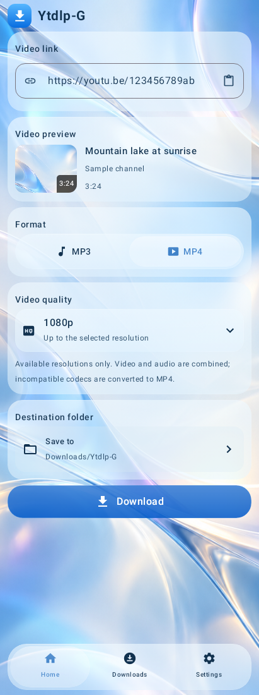
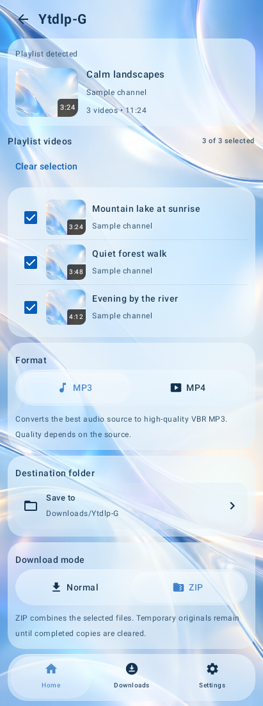
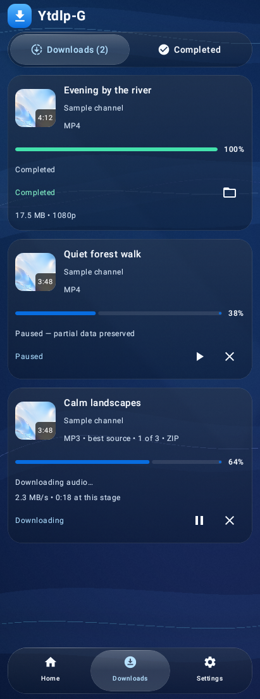
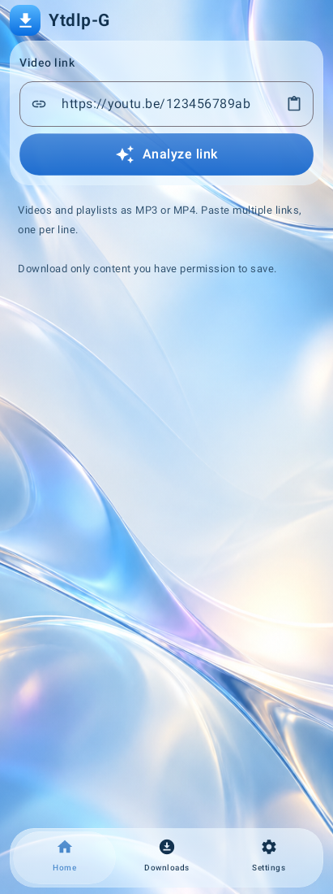
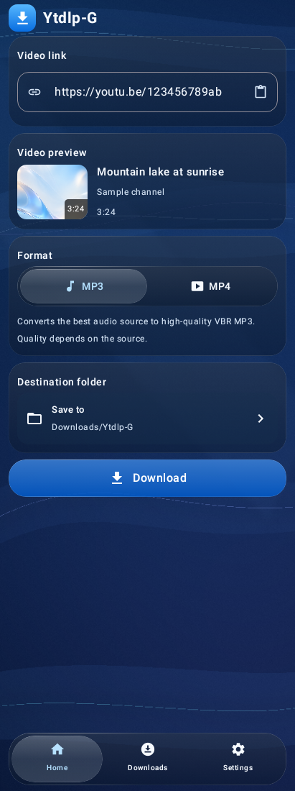
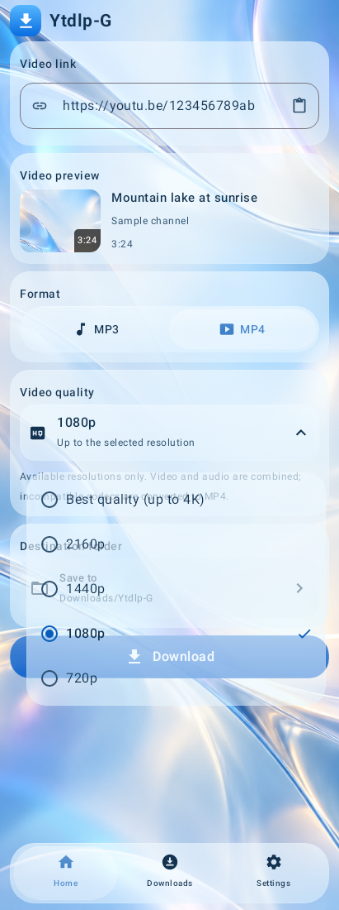
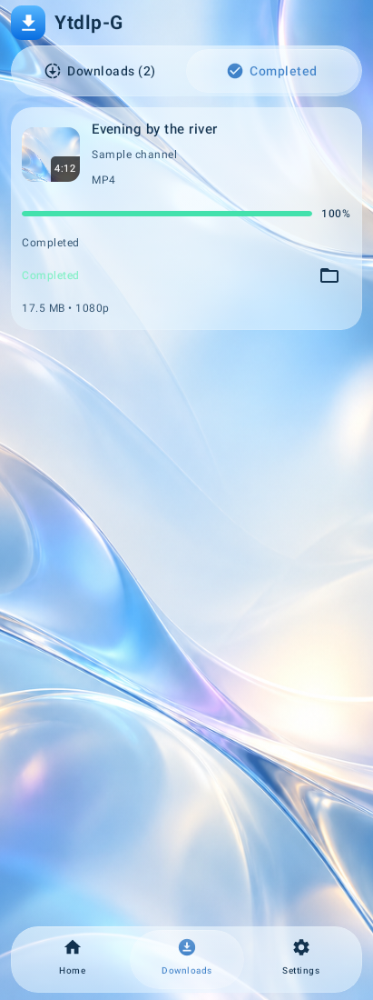
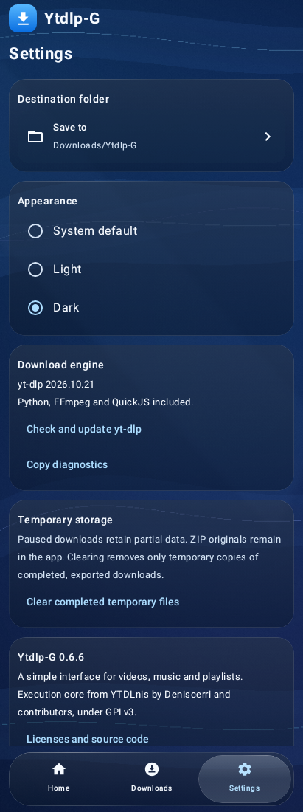
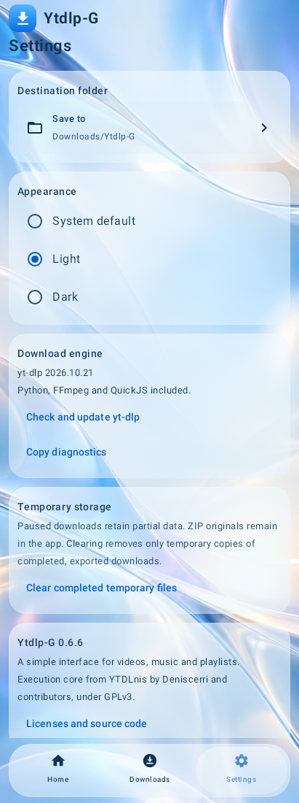

# Ytdlp-G

A compact Android downloader for YouTube videos, music and playlists, with an interactive blue Liquid Glass interface.

**[Download Ytdlp-G.apk](https://github.com/fuhbe/Ytdlp-G-Android/releases/download/v0.6.6/Ytdlp-G.apk)** · [Official v0.6.6 release](https://github.com/fuhbe/Ytdlp-G-Android/releases/tag/v0.6.6) · [Changelog](CHANGELOG.md) · [Report an issue](https://github.com/fuhbe/Ytdlp-G-Android/issues)

**Stable version 0.6.6 · Android 8.0+ · ARM64 · GPL-3.0-only**

## Features

- Analyze a video, playlist or multiple YouTube links before downloading.
- Convert the best available audio source to high-quality VBR **MP3**.
- Save **MP4** at available resolutions up to 2160p. Compatible H.264/AAC streams are copied or remuxed; other codecs are converted when needed.
- Select playlist entries and save individual files or a **ZIP** archive.
- Pause, resume and cancel jobs, with persistent queue and per-item results.
- Keep successful items when another item fails and retry eligible failures.
- Choose an output folder and follow downloading, processing, validation and export stages.
- Use light, dark or system appearance, with draggable glass selectors and a spring response.

Python, yt-dlp, FFmpeg, FFprobe and the JavaScript runtime are bundled. No separate Python installation is needed.

## Screenshots

These are **genuine captures of the final 0.6.6 application's Compose windows**, using labeled sample metadata and bundled-wallpaper thumbnails. They are software renders, not device photographs or recordings of live downloads. The application controls and sample content shown are English. [All 18 captures and provenance](docs/screenshots/0.6.6/README.md).

| MP4 and quality | Playlist | Downloads |
|:---:|:---:|:---:|
|  |  |  |

| Home | MP3 | Quality menu |
|:---:|:---:|:---:|
|  |  |  |

| Completed | Settings | Version and credits |
|:---:|:---:|:---:|
|  |  |  |

## Install and use

1. Download **Ytdlp-G.apk** from the [official release](https://github.com/fuhbe/Ytdlp-G-Android/releases/tag/v0.6.6). Source and verification ZIPs are optional developer files.
2. Install the APK on an ARM64 Android phone. Allow installation from the browser or file manager if Android requests it.
3. Paste or share a YouTube link, then tap **Analyze link**.
4. Select MP3 or MP4, an available quality and a destination. For playlists, choose entries and Normal or ZIP output.
5. Tap **Download** and follow the job in **Downloads**.

On Android 10+, the default destination is `Downloads/Ytdlp-G`. On Android 8/9, choose a folder first. ZIP output is offered when at least two entries are selected. Some messages from preserved runtime components can retain their original language.

MP4 conversion can take longer than downloading, especially at high resolutions, and cannot improve source quality. Network conditions and source availability affect downloads.

### Updating

Android requires matching signing certificates for an in-place update. Check `release-info.json` for this release's certificate and signing mode. If Android rejects an older differently signed installation, finish/export needed files before uninstalling it: uninstalling clears private settings, queued jobs and partial files. Already exported files in Downloads or the chosen external folder remain.

## Liquid Glass

The existing implementation combines shared content capture with a draggable lens, progressive icon illumination, edge reflections and elastic deformation. A captured horizontal gesture continues following the same finger during diagonal movement and confirms its horizontal destination on release. Normal vertical scrolling and genuine gesture cancellation retain their behavior.

Android 13+ supports the advanced Backdrop shader lens. Android 12 uses the existing cached-content mesh path when hardware rendering and device resources permit it. Older Android versions, software rendering, low-memory conditions and power-saving mode use the compatible glass fallback. Effects vary with the supported rendering path; no universal frame-rate guarantee is made.

The visual integration preserves Square and Backdrop attribution and licenses. [Implementation and compatibility details](docs/releases/0.6.6/LIQUID_GLASS.md).

## Verification and source

Version 0.6.6 promotes the device-approved implementation, with final version metadata and English presentation labels. The download engine, dependencies, queue, storage, workers, services, gesture behavior, animations and optical calculations are preserved.

The release provides APK/source checksums, signature information, automated results and screenshot provenance. [Final build and verification report](docs/releases/0.6.6/DELIVERY.md).

The published application lives in **[minimal/](minimal/README.md)**. Build the [v0.6.6 tag](https://github.com/fuhbe/Ytdlp-G-Android/tree/v0.6.6) with JDK 21, Python 3, Android SDK 36 and build tools 36.0.0. Historical editions remain in the repository and are not the target for this APK. Earlier releases and tags remain available.

## License and credits

GPL-3.0-only. See [LICENSE](LICENSE), [NOTICE.md](NOTICE.md) and the source/license assets accompanying the release. Credits include [YTDLnis](https://github.com/deniscerri/ytdlnis), [yt-dlp](https://github.com/yt-dlp/yt-dlp), [Square](https://github.com/Lelonio/Square) and [Backdrop](https://github.com/Kyant0/AndroidLiquidGlass). Bundled dependencies retain their respective licenses.

Download only content you have permission to save and follow the source site's terms.
