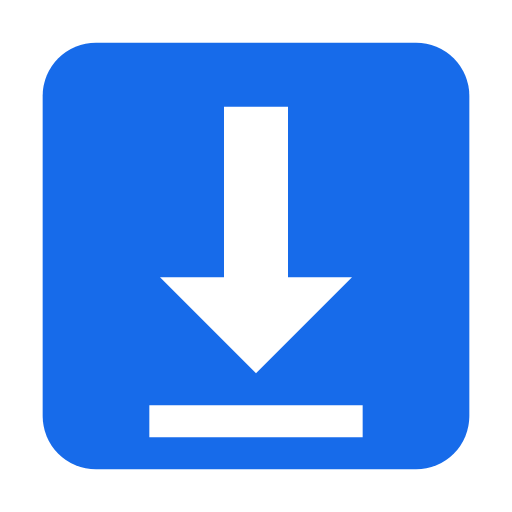
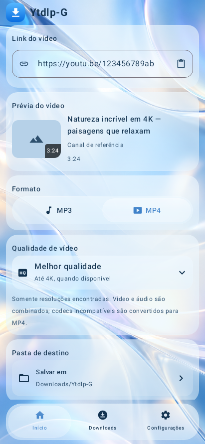
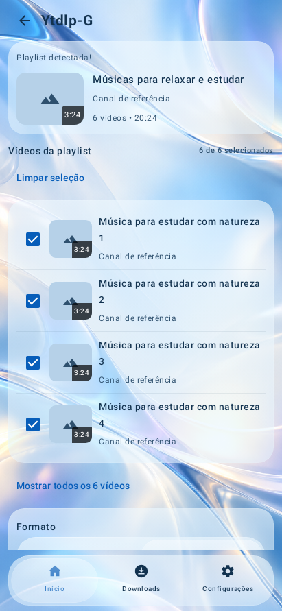
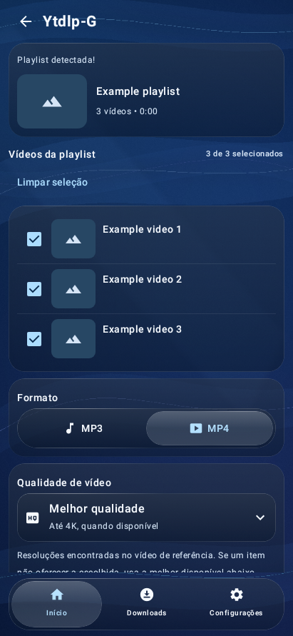

# Ytdlp-G for Android

Download videos, music and playlists with a blue Liquid Glass interface. Paste a link, choose **MP3** or **MP4**, and save individual files or a playlist ZIP.

**[Download 0.6.6-test3](https://github.com/fuhbe/Ytdlp-G-Android/releases/download/v0.6.6-test3/Ytdlp-G.apk)** · [Release notes](https://github.com/fuhbe/Ytdlp-G-Android/releases/tag/v0.6.6-test3) · [Stable 0.6.4](https://github.com/fuhbe/Ytdlp-G-Android/releases/tag/v0.6.4) · [Report an issue](https://github.com/fuhbe/Ytdlp-G-Android/issues)

**Android 8.0+ · ARM64 · GPL-3.0-only**

## Features

- Preview single videos, playlists and multiple YouTube links before downloading.
- Convert the best available audio source to high-quality MP3.
- Download MP4 at an available resolution, up to 2160p. Compatible H.264/AAC streams are copied or remuxed; other codecs are converted when needed.
- Select playlist entries and save separate files or one ZIP.
- Keep successful files when an item fails, review errors and retry eligible items.
- Pause, resume or cancel jobs and follow progress in the download manager.
- Choose a destination folder, with light and dark glass themes.

Python, yt-dlp, FFmpeg, FFprobe and the JavaScript runtime are included.

## Liquid Glass previews

Actual Compose application captures from the approved 0.6.6-test3 CI run, with sample metadata and placeholder thumbnails. These software previews show the Portuguese interface, not a live download or a measurement of hardware refraction.

| Video | Playlist | Dark theme |
|:---:|:---:|:---:|
|  |  |  |

[More previews and their provenance](docs/screenshots/0.6.6-test3/README.md)

## What's new in 0.6.6-test3

The shared glass sliders now select their first and last options when dragged to the edges, including the inner margins. Releasing retains the selected destination while the elastic animation settles. Standard Material touch flashes are disabled locally in the four sliders; glass reflections, lighting and elastic response remain.

The approved APK is published unchanged, without rebuilding or re-signing. Downloads, media engines, playlists, ZIP, existing settings and wallpapers retain their behavior. **172 automated tests passed, with two explicit rendering skips.** The project owner approved this build after testing on Android 12. [Release and verification details](docs/releases/v0.6.6-test3.md).

Stable **0.6.4** remains available unchanged. Version **0.6.6-test3** retains its preview identifier.

## Install and use

1. Download **Ytdlp-G.apk** from the version you want in [Releases](https://github.com/fuhbe/Ytdlp-G-Android/releases).
2. Install it on an ARM64 Android phone. Allow installation from your browser or file manager if Android asks.
3. Paste or share a link, then tap **Analisar link** (Analyze link).
4. Choose MP3 or MP4, quality and destination. Select playlist entries and ZIP when needed.
5. Tap **Baixar** (Download), then follow the job in **Downloads**.

On Android 10+, the default destination is `Downloads/Ytdlp-G`. On Android 8/9, choose a destination first. MP4 conversion can take longer than downloading, especially at high resolutions, and cannot improve source quality.

Already installed the approved Actions test3 APK? This is the same file. Its signing certificate differs from older previews and 0.6.4; Android cannot update those installations in place. Export needed files before uninstalling an older build, which clears private settings, jobs and partial files.

## Source and verification

The source matching the published APK is in the [v0.6.6-test3 tag](https://github.com/fuhbe/Ytdlp-G-Android/tree/v0.6.6-test3), under `minimal/`, and in the corresponding-source ZIP attached to the release. Historical branches and earlier editions remain available; choose the version tag before building.

Use JDK 21, Python 3, Android SDK 36 and build tools 36.0.0. Follow the [versioned build instructions](https://github.com/fuhbe/Ytdlp-G-Android/blob/v0.6.6-test3/minimal/README.md). The release also includes checksums, original verification reports, icon and screenshots.

[Successful original build](https://github.com/fuhbe/Ytdlp-G-Android/actions/runs/40018985216) · [Screenshot provenance](docs/screenshots/0.6.6-test3/PROVENANCE.json)

## License and credits

GPL-3.0-only. See [LICENSE](LICENSE) and [NOTICE.md](NOTICE.md). Credits include [YTDLnis](https://github.com/deniscerri/ytdlnis), [yt-dlp](https://github.com/yt-dlp/yt-dlp), [Square](https://github.com/Lelonio/Square) and Backdrop. Bundled dependencies retain their respective licenses; corresponding source and notices accompany the APK.

Download only content you have permission to save and follow the source site's terms.
