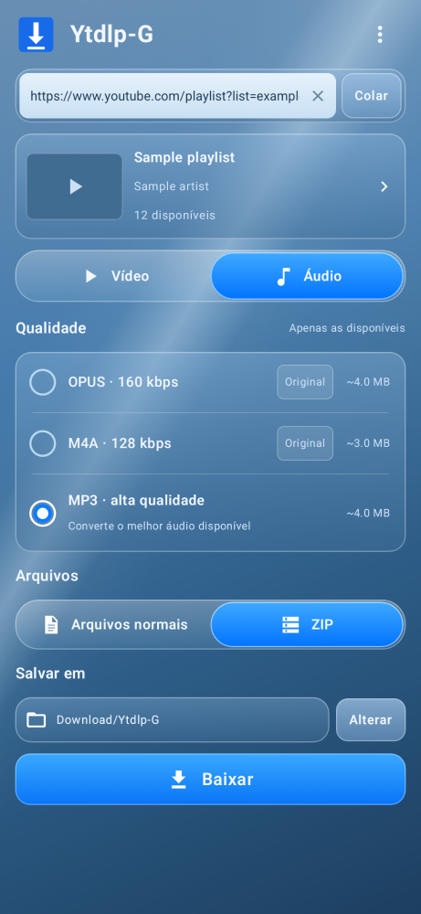
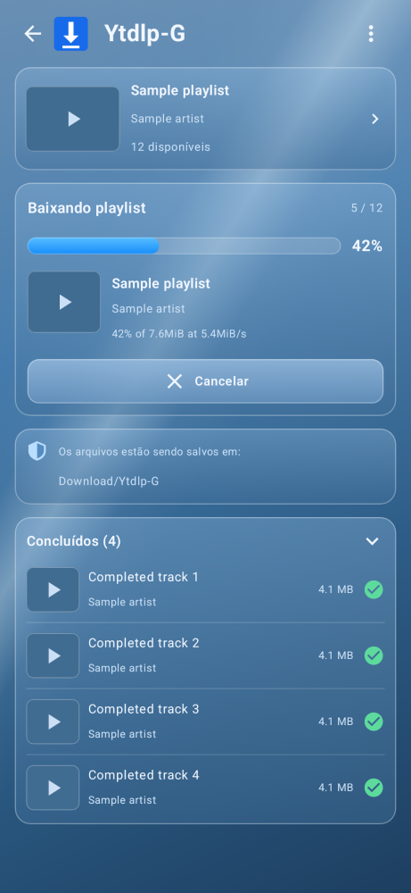

# Ytdlp-G for Android

A small video and playlist downloader for Android, with a translucent interface. Paste a link, inspect qualities that are actually available, and save regular files or one ZIP. The interface follows the device language in English, Brazilian Portuguese, and Spanish. On Android 13 and later, you can also choose the app language in system settings.

## Current status

The current preview is 0.3.0-beta.1. It follows the original glass design with a compact link bar, video/audio tabs, a quality panel and a separate download screen. Recent inspections are cached, playlist entries are checked two at a time, and analysis can be cancelled. Downloads include item-level results and source error details. Please include the copied error details when reporting a failing link.

The app bundles the [yt-dlp Android library](https://github.com/JunkFood02/youtubedl-android), Python, FFmpeg and QuickJS. The official yt-dlp 2026.10.21 zipapp and its YouTube JavaScript solver are downloaded and checksum-verified during the build. App upgrades replace the previously installed extractor. No separate Python installation is required. Android 8.0 or newer is required. Android 10+ can save directly to Download/Ytdlp-G; a folder picker is also available. Download only material you have permission to save and follow the source site's terms.

## Interface

Layout renders using sample data:

 

## Build

Open the project in Android Studio, or install Android SDK Platform 35, Python 3 and Java 17, then run `./gradlew :app:assembleDebug`. Find the APK in `app/build/outputs/apk/debug/`. GitHub Actions publishes the APK and its SHA-256 as workflow artifacts. Debug builds carry a development certificate. If an older preview has a different certificate, uninstall it before installing the new APK; files already saved in Downloads are retained.

## Verification

Run `./gradlew :app:verifyPaparazziDebug :app:lintDebug` for the format, playlist, ZIP and screen regression checks. Run `python3 scripts/check_apk.py app/build/outputs/apk/debug/app-debug.apk` to check the actual engine, JavaScript solver and native dependencies in the APK. With FFmpeg installed, `python3 scripts/smoke_runtime.py app/build/generated/runtime/res/raw/ytdlp` exercises the pinned engine against a local HTTP fixture and performs a real MP3 conversion. Translation keys are checked with `python3 scripts/check_translations.py`.

## License

GPL-3.0-only. See [LICENSE](LICENSE). Third-party components retain their respective licenses; see [NOTICE.md](NOTICE.md).
