# Actual test3 application captures

All images come from the verified final GitHub Actions artifact: **actual AppContent/Popup**, labelled sample video metadata, Robolectric/native Skia **SOFTWARE**. No mockups, physical-phone/GPU captures or real-time FPS claims are made. Full46 raw PNG/state pairs are in the verification artifact. GIFs crop and quantize those authentic frames and slow playback; they do not fabricate intermediate UI frames.

## One anchored button body

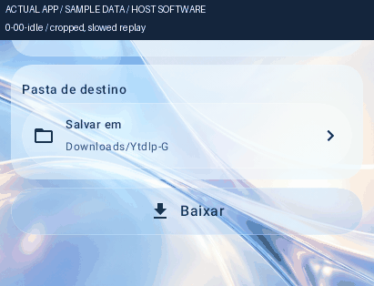

| Rest | Long horizontal pull | Exact settled return |
| --- | --- | --- |
| 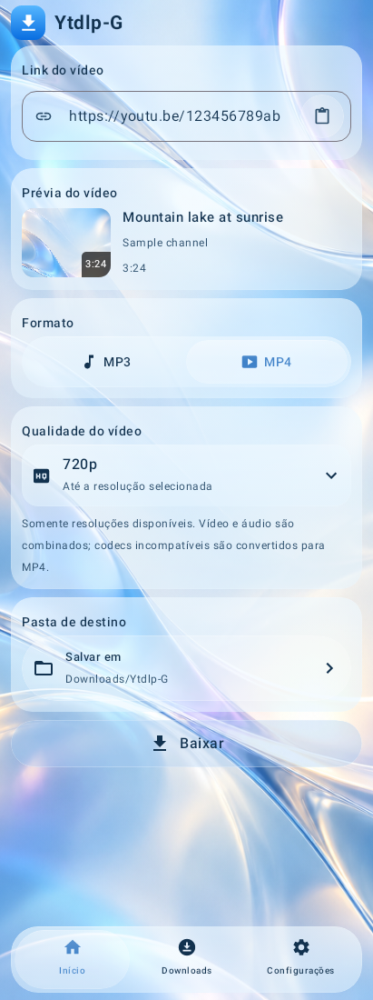 | 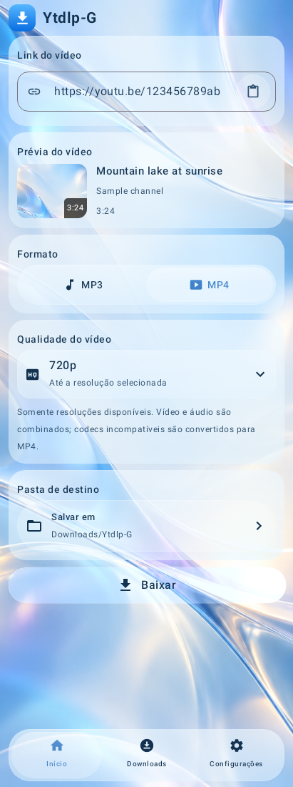 |  |

The label, icon and click target stay in their original layout. The surface has a small resistant extension; there is no floating visual clone. Normal vertical scrolling still moves the card with the page. Same-pointer vertical/diagonal escape, cancellation and lazy-disposal cleanup are additionally covered by the regression suite.

## Select1080p with one tap before spring settling

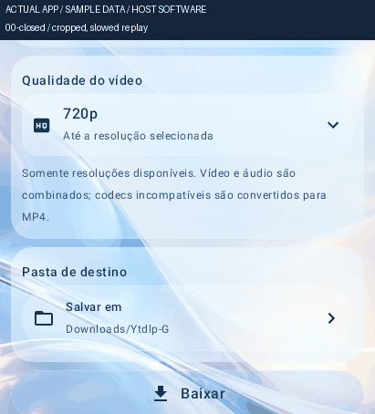

| Visible during the opening spring | First tap has selected1080p | Closed with1080p selected |
| --- | --- | --- |
| 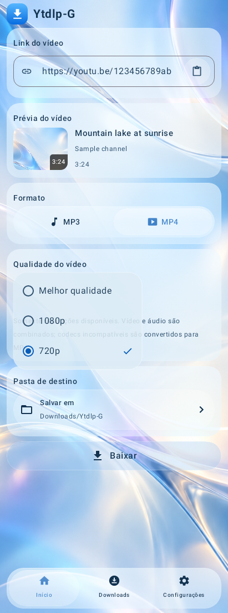 | 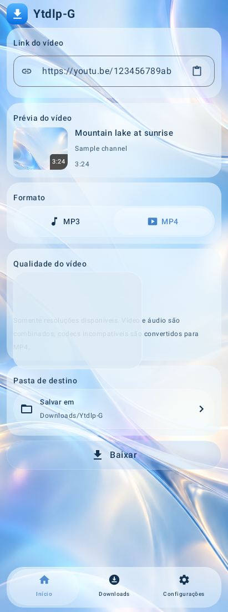 |  |

The matching frame JSON proves the opening spring is still running in the visible frame, that the first actual touch changes the model from720 to1080 and starts reverse closure, and that the final selector retains1080p. Only the real fixture choices Best/1080/720 are used; no download success is simulated.

## Full sequences and compatibility layouts

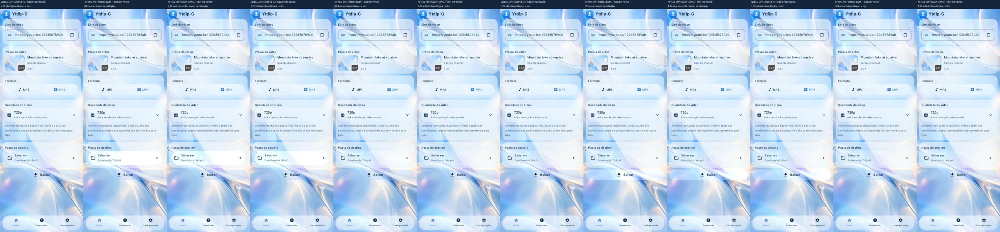
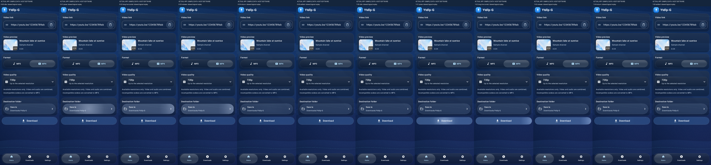
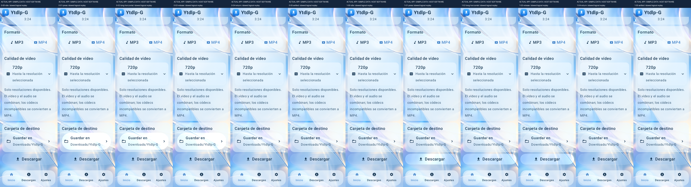
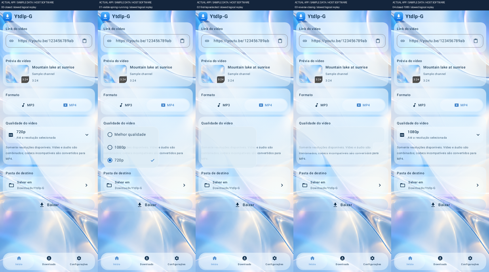
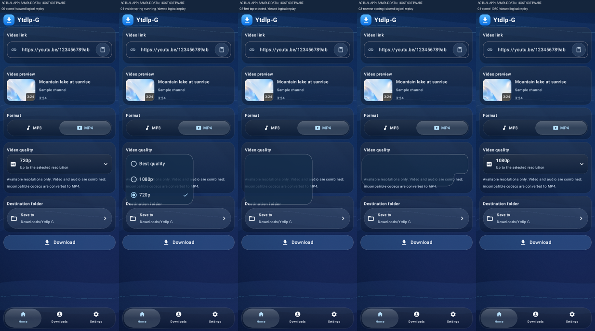

## Before/after evidence

The owner supplied physical images of the floating/duplicated controls. The before-fix host reproductions in [REPRODUCTION.json](../REPRODUCTION.json) fail for oversized body travel, two simultaneous content compositions and the ignored first visible tap. The same regression family passes after the patch; API26/32/35 early-tap variants are included. A two-composition host measurement is not claimed as a physical GPU pixel recording.

Test3 structurally has one in-place representation. Published source guards verify that material/highlight/cache, SDF/physics/shaders, all four selectors, languages and download logic remain unchanged. [PROVENANCE.json](PROVENANCE.json) maps each published image/GIF to its original CI pixels and SHA-256 hashes. Device optical/frame-time acceptance is still pending.
