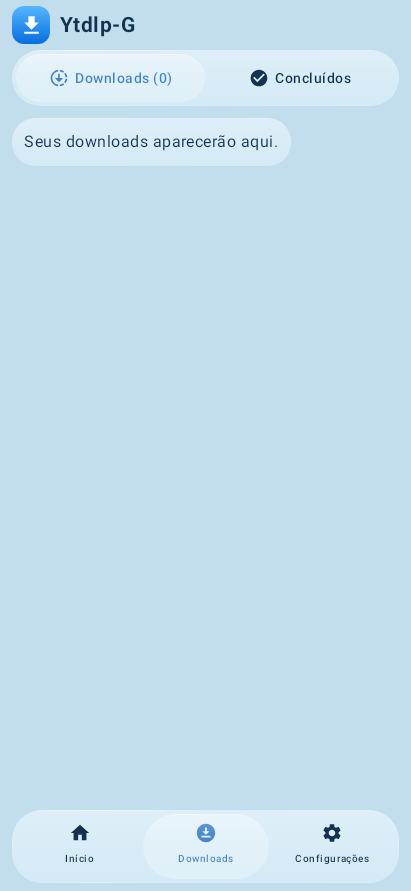

# Ytdlp-G 0.6.6-test3 interface previews

These PNGs are unedited captures of the actual Compose application from successful [Actions run 40018985216](https://github.com/fuhbe/Ytdlp-G-Android/actions/runs/40018985216). They use sample metadata and placeholder thumbnails, rendered with Robolectric native Skia software. They are not phone photos, live download captures or proof of hardware shader behavior.

| Video | Playlist | Dark theme | Download manager |
|:---:|:---:|:---:|:---:|
|  |  |  |  |

The manager shows the initial empty state. Screens scroll normally; these images capture one viewport. The interface text shown is Brazilian Portuguese. Public documentation is English.

[PROVENANCE.json](PROVENANCE.json) maps every image to its original report path and SHA-256 digest. The publication workflow verifies byte-for-byte equality against the original CI reports before releasing the screenshots ZIP.
