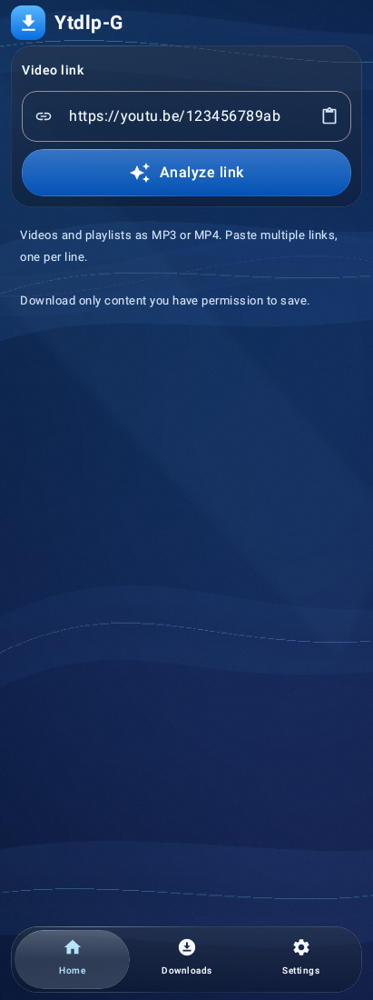
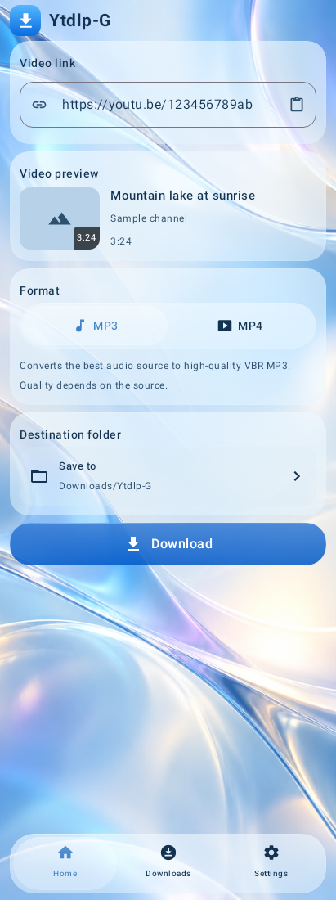
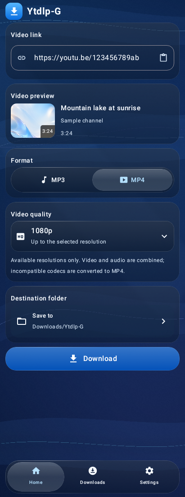
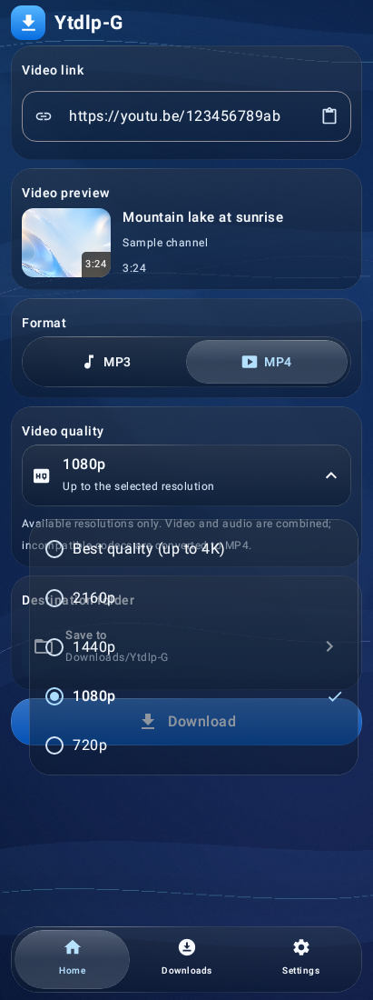
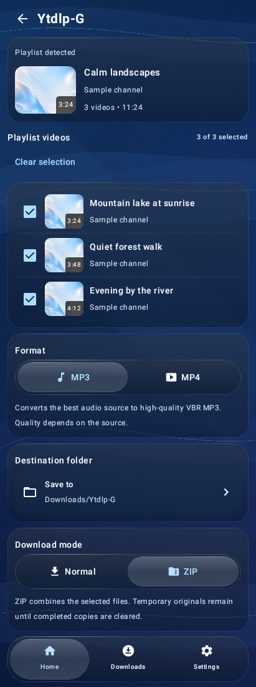
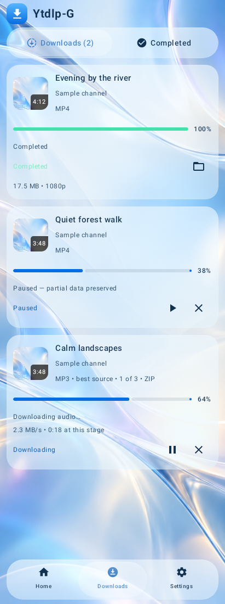
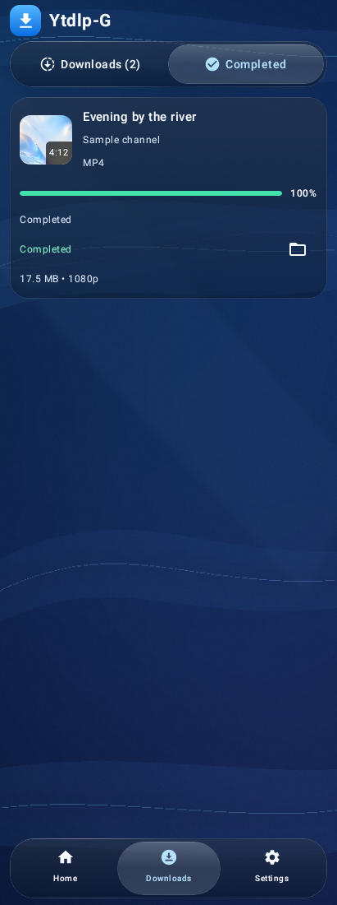
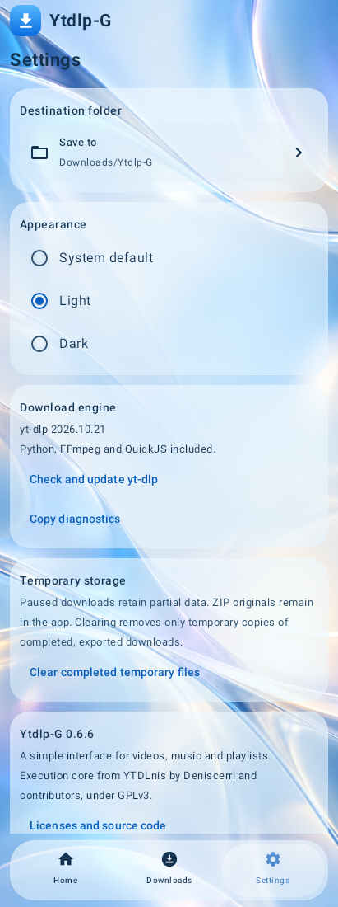
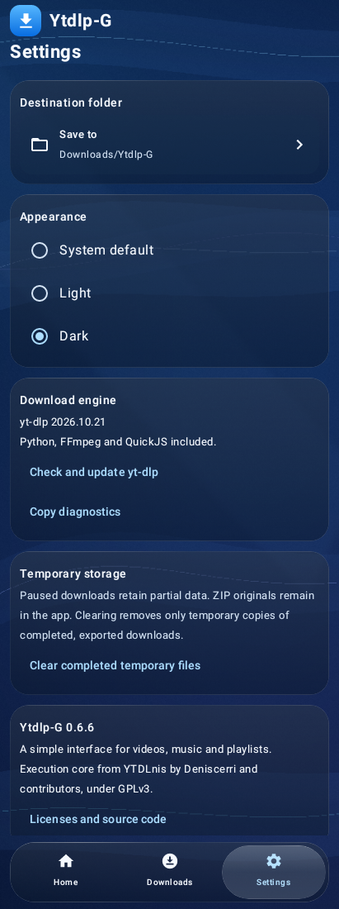

# Ytdlp-G 0.6.6 screenshots

These are genuine captures of the final **0.6.6** application's Compose windows. The capture fixture asserts the application code version before drawing the actual application views, including the quality popup's separate WindowManager window at its measured position.

**Sample data:** media titles, channel names, queue states, progress and saved-file entries are fixtures. Thumbnails use the app's bundled wallpaper. No URL analysis or download is invoked by this fixture. These are software renders, not mockups, device photographs, live-transfer recordings or GPU/refraction measurements.

The controls and sample content are English. The Android 12 software-rendered path is shown. Advanced effects vary with the supported hardware path; the source implementation is unchanged from the device-approved build. Images capture one viewport of normally scrollable screens.

| Screen | Light theme | Dark theme |
| --- | --- | --- |
| Home |  |  |
| MP3 selected |  |  |
| MP4 selected |  |  |
| MP4 quality popup |  |  |
| Playlist selection |  |  |
| Downloads and sample queue |  |  |
| Completed tab |  |  |
| Settings |  |  |
| Version and source credits |  |  |

[PROVENANCE.json](PROVENANCE.json) records the exact source commit, renderer, image dimensions/digests and all 18 original final-build captures. The publisher compares every PNG byte-for-byte with its CI report artifact.
