# Actual experimental app captures

These are genuine AppContent/Popup captures with labelled **sample metadata**, generated by the final CI test suite using Robolectric/native Skia **software**. They are not mockups, physical phone recordings, emulator captures, GPU refraction evidence or FPS measurements. Full original PNGs/states and checksums are in the verification artifact. GIFs are cropped, palette-quantized and slowed for inspection; no intermediate app pixels are fabricated.

## Buttons and menu

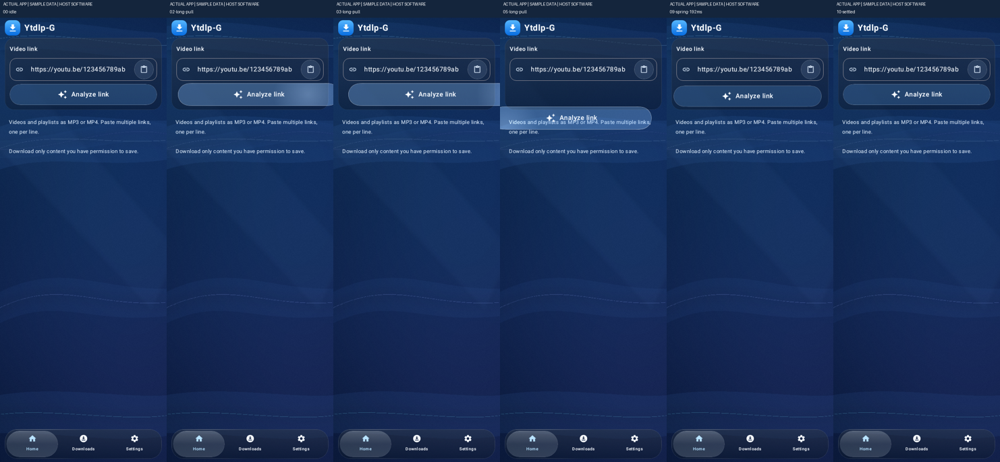
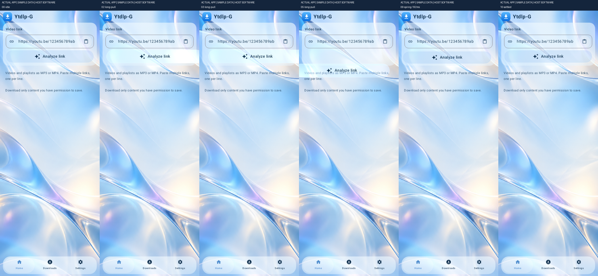

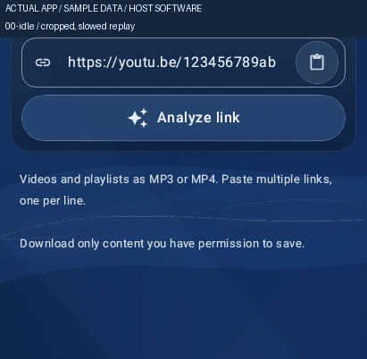

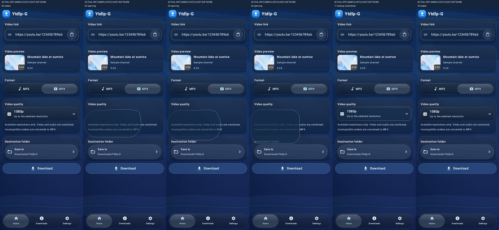
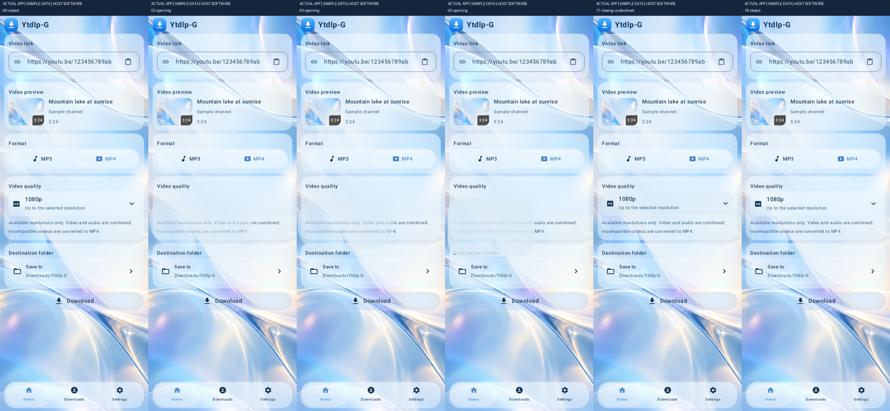

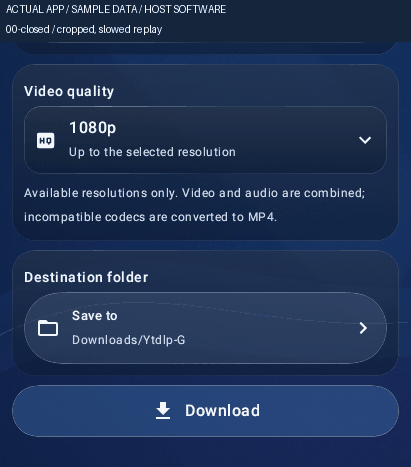

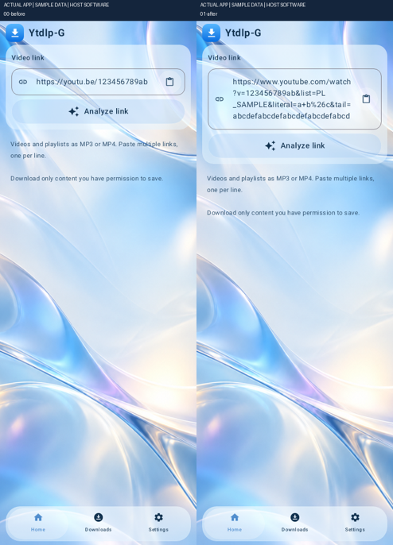

## Before and after

These compare independent recorded test1 and test2 gesture samples/phases. They do not use identical gesture amplitudes or elapsed times and cannot establish a speed/FPS improvement. The final real-window tests separately prove >24dp long-pull visual travel, uninterrupted tracking and no action after an intentional drag.

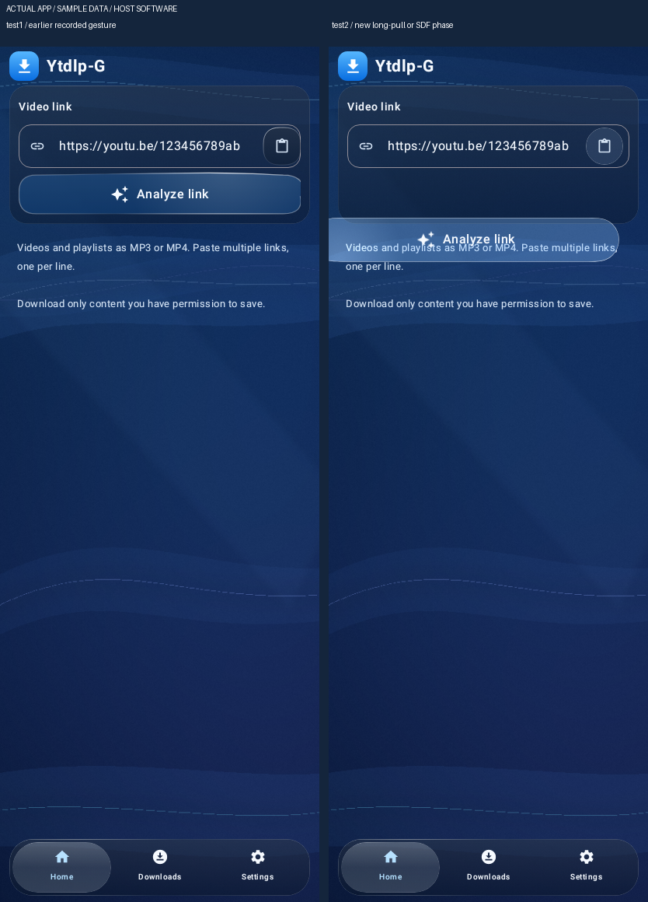
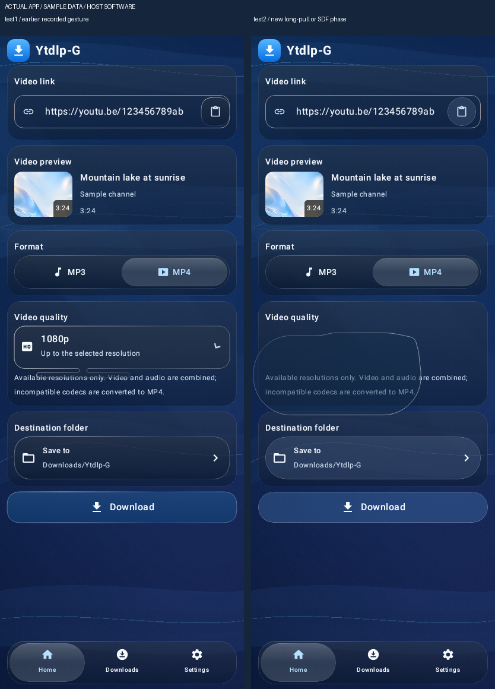

## Three app languages

The additional owner-requested language setting uses existing Liquid Glass buttons. Captures show the actual settings UI at320dp; screen text changes immediately without restarting jobs.

| English | Português (Brasil) | Español |
| --- | --- | --- |
| 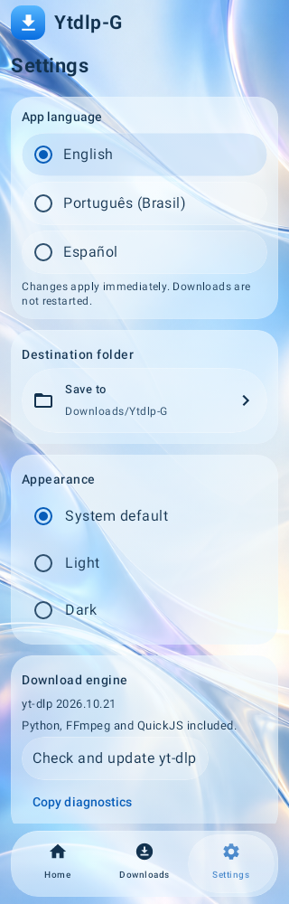 | 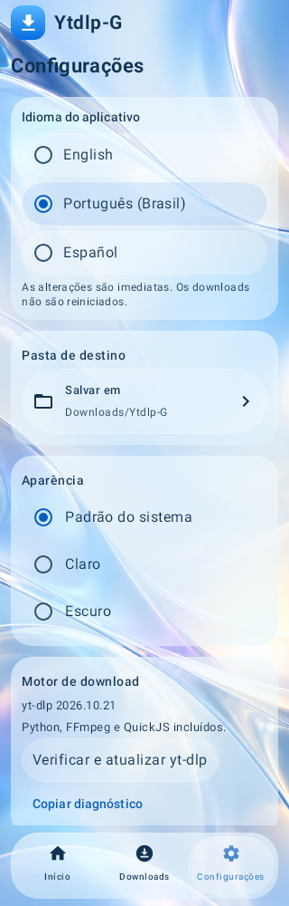 | 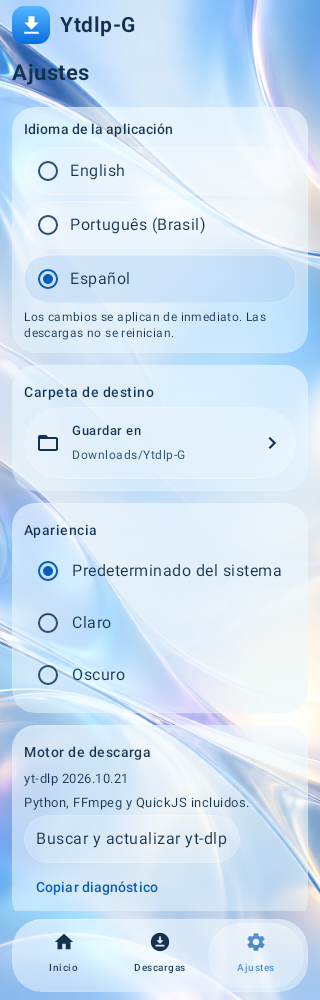 |

## Reference versus verified result

| Observable reference behavior | Actual implementation/evidence | Remaining limit |
| --- | --- | --- |
| One elastic clear body follows a long pull, without pinching into two halves | Actual Square G2 capsule/matrix, bounded added travel; window-level pointer captures and single-cross-section raster proof | Phone optical/latency acceptance still required |
| iOS-like two-body liquid separation and absorption | MIT physics/J-curve/phase port; SDF smooth union creates87 rasterized fusion pixels outside both original shapes; captured opening/closing/undershoot | Independent sample phases, not pixel-identical Apple physics |
| Background visibly bends through the narrow optical neck | Extra API33 SDF-gradient/Snell shader sampling cached real screen content, compiled by actual RuntimeShader | No physical GPU displacement evidence yet; Android12 shows SDF contour and blur, not arbitrary-neck lens refraction |
| iPhone rim/specular light moves with the finger | Original Square InteractiveHighlight shader/gains and compatible pointer light; actual app pull frames | Software screenshots cannot establish hardware optical equivalence |

The conversation’s iOS stills remain the qualitative reference. No Weather/Edit video was attached to this request, and no fabricated iPhone capture is substituted. [PROVENANCE.json](PROVENANCE.json) maps every published derivative to its actual input files and SHA-256 hashes.
