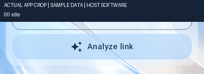
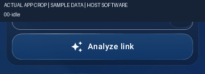
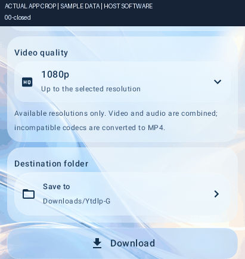
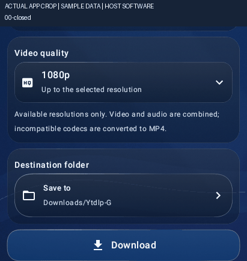
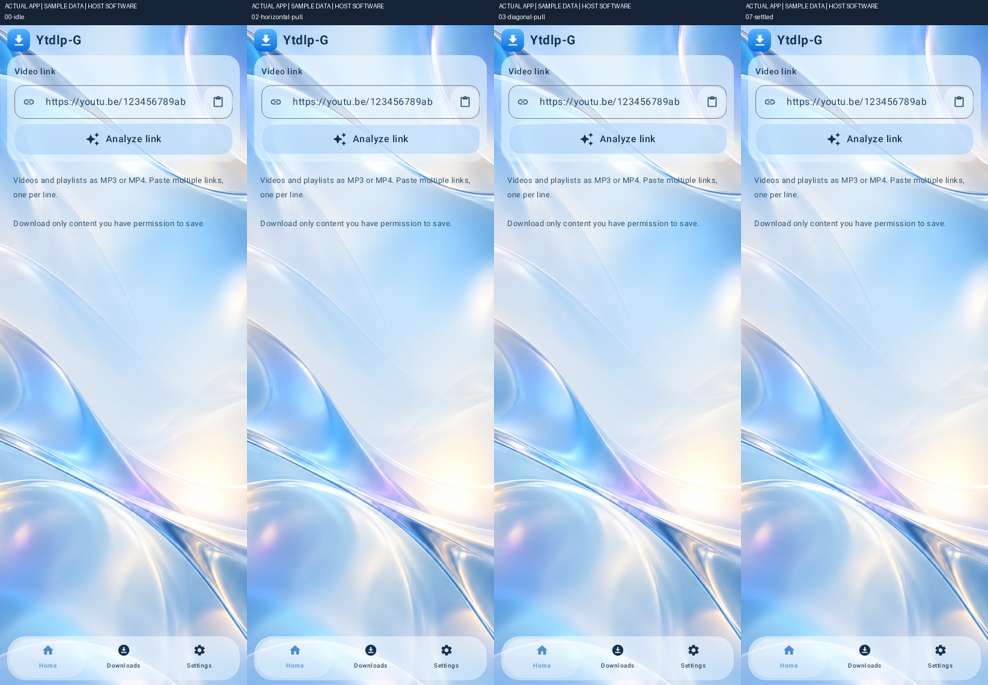
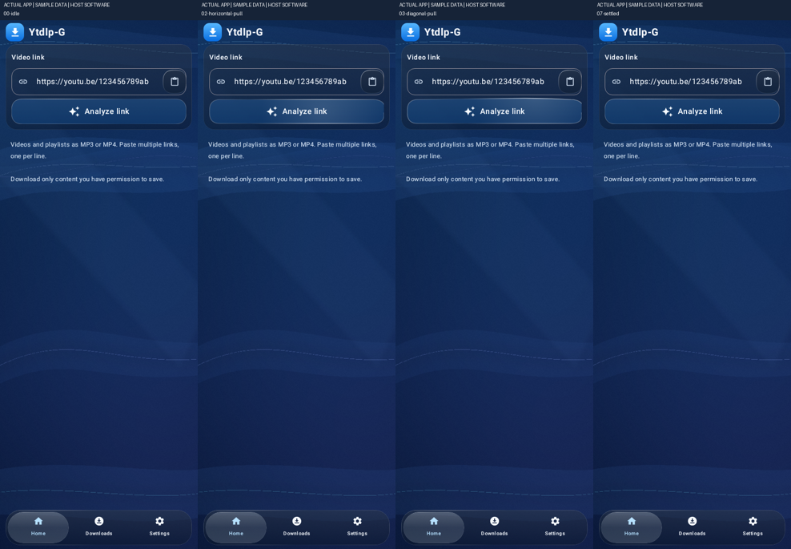
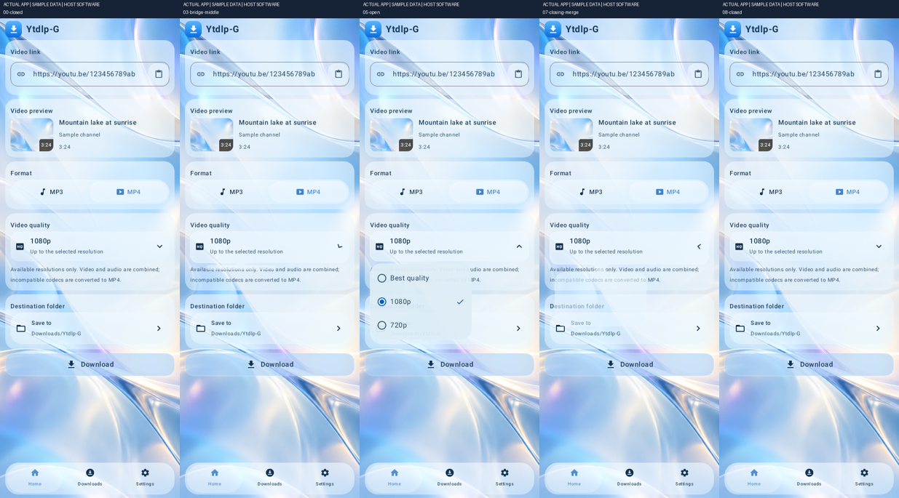
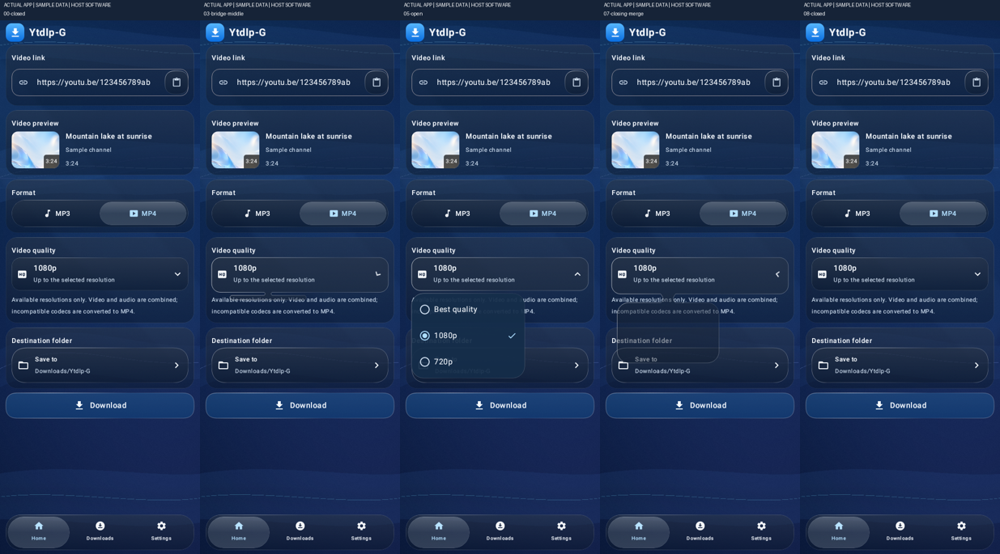
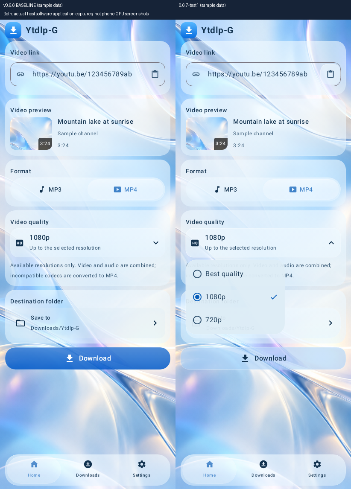

# Actual experimental app captures

These are genuine application/Popup-window captures with **sample metadata**, rendered by **Robolectric native Skia in software**. They are not mockups, emulator runs, physical-phone screenshots or proof of GPU optics/performance. GIFs crop the original captured app pixels to show the interaction clearly; replay is slowed for inspection, not real-time phone video. Full uncropped frames, state metadata and hashes are in the verified Actions artifact. [Provenance](PROVENANCE.json).

| Elastic action button — light | Elastic action button — dark |
| --- | --- |
|  |  |

| Quality menu morph — light | Quality menu morph — dark |
| --- | --- |
|  |  |

## Full application sequences

## Approved baseline versus experimental menu

The neck silhouette is real custom geometry. In these software captures it uses the compatible tinted material, not physical GPU refraction. Android12 menu-neck captured-screen blur is not an optical lens. See [rendering limits](../README.md) and [Redmi acceptance](../TESTING.md).
