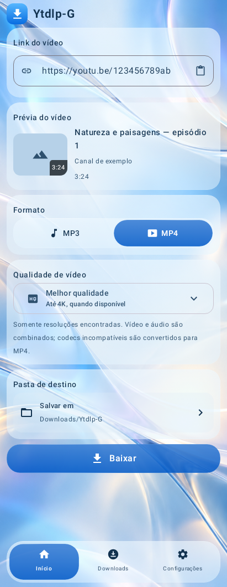
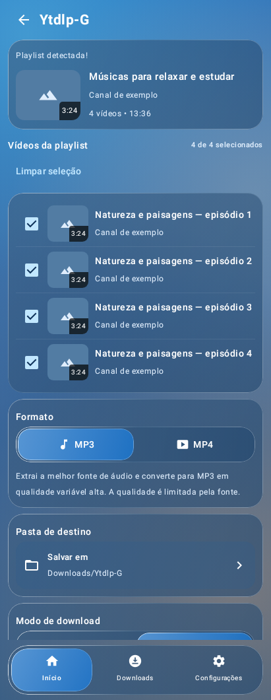
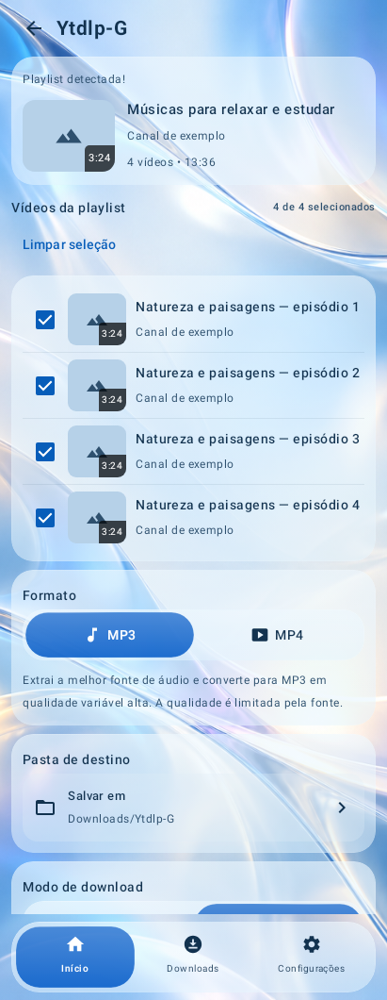
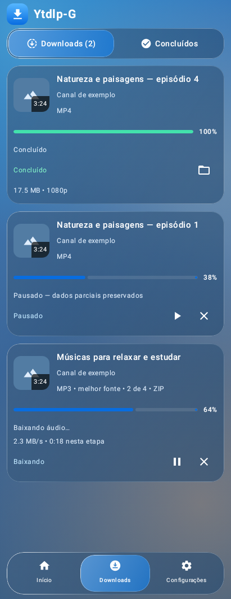
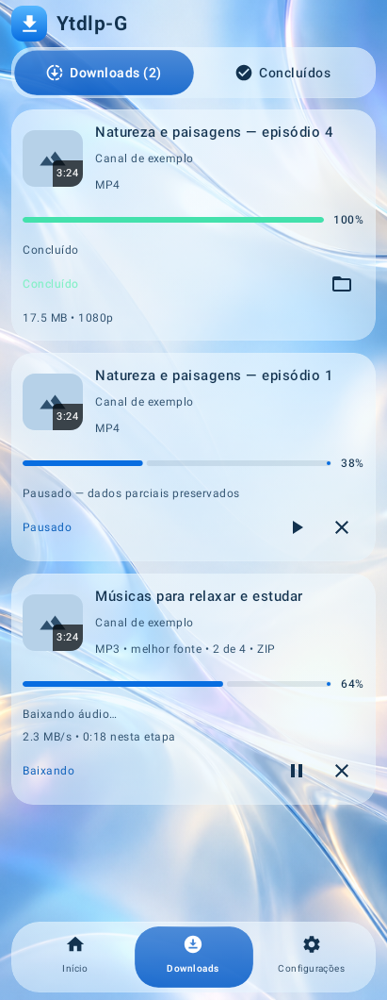
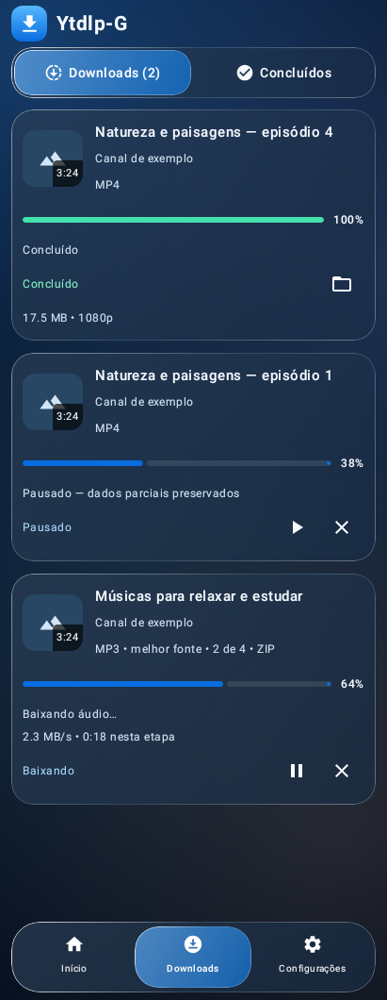
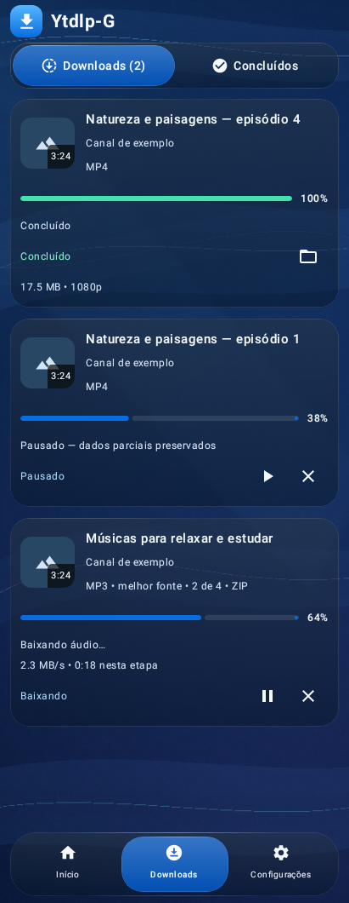

# Ytdlp-G 0.6.4 — Liquid Glass visual evolution

This test branch derives directly from working visual 0.6.3 at
`acd71d2cfaddd8b5b626d6cfa8559e58937bb5d6`. Stable main/v0.6.2 and the original
0.6.3 visual branch are preserved. Identity remains Ytdlp-G,
`com.fuhbe.ytdlpg.minimal`, Android 8+ / ARM64, distribution name **Ytdlp-G.apk**.

## Baseline and scope

Before editing, the exact 0.6.3 branch built its release and instrumentation APKs
and executed 89 JVM cases: 88 passed, zero failures/errors, one previously documented
host-Skia child-shader skip. BASELINE.json records every original case and all
85 tracked minimal-module file hashes. The original 57 functional tests are unchanged.
Instrumentation was compiled, not executed.

The scope guard verifies 82 protected tracked files byte-for-byte. It reverses
only the exact four presentation substitutions in MainActivity and then compares
the whole file with 0.6.3. It normalizes only version metadata in Gradle and
compares the whole build file. Dependencies, minSdk, ABI, manifest, permissions,
signing rules, entry points, share intents, operational strings, quality dropdown,
VM callbacks, models, yt-dlp/Python/FFmpeg/QuickJS, queue, ZIP, export, storage,
database, services/workers, notifications and all previous test sources remain intact.
No new destination, control, menu, configuration or downloader capability is added.

## Sliding capsule and input

The dock now has **one moving decorative capsule**. Existing destination labels
and Surface callbacks stay the same. A normal click, keyboard activation or
accessibility action uses the existing callback. The selected destination remains
a current-page indicator without a duplicate click action.

Horizontal dragging must win touch slop inside the reserved dock before it can
consume movement. It moves the capsule without changing the application area.
Only a valid final release dispatches one existing destination callback. A release
outside the track, pointer cancellation or a multi-touch interruption restores
the current selection. Returning to the current destination invokes no callback.
Vertical/outside gestures and the reserved system-navigation region are not captured.
The visual overlay has no click handler; it cannot start or cancel transfers.

A finite damped spring follows the target, with light compression and an animated
specular field. Compose's standard Android animation duration scale applies; there
is no custom frame loop or infinite animation. The existing segmented controls
also reuse one sliding decoration, retaining the same options and onSelected values.
Resolution selection remains the original dropdown.

## Real material and original wallpapers

The dependency remains **Backdrop 1.0.3**. No SDK/Kotlin/Compose or download-library
upgrade was needed. It samples the actual displayed wallpaper through a shared
graphics layer. The dock exports its own sampled, tinted background layer so the
moving capsule can refract the actual material beneath it. Text/icons are drawn
above the capsule; no recursive capture or full-screen animated foreground copy
is introduced.

Backdrop's highlight is enabled with its shader-free Plain style. A moving
specular edge/inner light responds to press, drag, selection and spring movement.
These are lighting effects, not a fixed bitmap advertised as refraction. Supported
lenses still use the actual dependency's AGSL/RuntimeShader backdrop effect.
Shadows stay in the existing Compose shadow modifier, avoiding duplicate shadows.

- **API 26–30:** lightweight tinted surfaces, gradient lighting and specular edges.
- **API 31–32:** actual sampled RenderEffect blur plus dynamic lighting/motion.
- **API 33+:** sampled blur and actual edge-lens refraction on essential surfaces,
  when the accelerated window/GPU supports them. Lens rejection falls back to blur.
- **Low RAM, memory class below 192 MiB, power saver or software renderer:** the
  existing inexpensive material tier. No minimum Android version was raised.

The two attached PNGs replace only the old procedural wallpaper. They are included
as exact original 1080×2400 files; WALLPAPERS.json records SHA256 values. The existing
theme is the sole selector. Center-crop preserves aspect ratio without stretching.
Decode runs on Dispatchers.IO and is sampled to at most 540×1200 (~2.6 MiB/theme);
an 8 MiB LRU cache retains both normal phone-theme bitmaps. The original PNGs are
unchanged in source/APK resources. No progress/transfer state enters the wallpaper.
Light-theme foreground/system-bar colors were adjusted for the bright supplied
image; dark-theme foregrounds remain light. No functional text was edited.

## Comparison: identical UI states

The before files are the actual 0.6.3 baseline renders. After files use the same
fixture metadata and queue states, rendered from real Compose components. Four
additional after captures cover Home/playlist dark and Settings in both themes.
All images below are **software-fallback renders with sample metadata**. They are
not live downloads, generated mockups or proof of physical-device GPU effects.

| Screen | 0.6.3 before | 0.6.4 after |
|---|---|---|
| Single video, light |  |  |
| Playlist, light |  |  |
| Downloads, light |  |  |
| Downloads, dark |  |  |

Additional actual UI renders: [Home dark](after/single-video-dark.png),
[playlist dark](after/playlist-dark.png), [Settings light](after/settings-light.png),
[Settings dark](after/settings-dark.png). Layout, controls, fixture content and
operational visibility follow 0.6.3; illustrative-only controls were not introduced.

## Verification and limits

The full workflow executes all previous JVM cases unchanged, 19 new dock scenarios,
two bitmap/theme/cache scenarios and eight actual UI captures. The original API
matrix provides 21 layouts across 26/28/31/33/35, including small-screen large text.
New dock drags also execute across those five APIs. Assertions cover actual pointer
input, cancellation/outside/system regions, correct callback identity/count,
keyboard focus/activation, selection accessibility, one capsule, intermediate
spring positions and capsule movement before navigation is dispatched.

During development, keyboard focus and first-frame measurement initially failed
in the new host tests. The keyboard case now explicitly enters keyboard input
mode and provides window focus. The animation case waits for the first clock frame
and observes the capsule's actual moving semantic bounds. Final results come
from the exact successful build and downloaded artifact, not those failed attempts.

The expected complete suite is **118 cases, 117 passes, zero failures/errors and
one existing host-Skia shader skip**. The delivery guard checks original case
identities/results, not just a matching count. Actual media fixture tests and the
unchanged HTTP/HLS/DASH/MP3/MP4/ZIP/R8 bootstrap smoke checks are also rerun.
No new live YouTube download or throughput optimization is claimed.

Seven instrumentation scenarios are built, including the preserved native pipeline
and actual AGSL checkerboard probe, plus the new Android dock-input acceptance.
**They are not counted as executed tests.** No usable physical Android/GPU is
connected; the previous no-KVM software-emulator attempt was unusable. FPS,
temperature, RAM, ANR, vendor GPU behavior and reference closeness require phone
acceptance. The build is a visual test release, not a claim of iOS-identical output
or universal hardware compatibility.

## Device acceptance

Download app and tests from the same successful Actions run. A fresh CI test
certificate may differ from installed 0.6.3/0.6.2. Updating with a mismatched key
is rejected by Android; uninstalling deletes private queue/settings/partials.
Finish/export needed work first or use a spare installation. The public stable
release remains available. Do not treat signing compatibility as a source-code fix.

```sh
adb install -r Ytdlp-G.apk
adb install -r Ytdlp-G-tests.apk
adb shell am instrument -w -r -e class com.fuhbe.ytdlpg.simple.GlassDockDeviceTest,com.fuhbe.ytdlpg.simple.LiquidGlassDeviceTest com.fuhbe.ytdlpg.minimal.test/androidx.test.runner.AndroidJUnitRunner
adb pull /sdcard/Android/data/com.fuhbe.ytdlpg.minimal/files/visual-test/
adb logcat -v threadtime YtdlpG-Glass:I AndroidRuntime:E '*:S'
adb shell dumpsys gfxinfo com.fuhbe.ytdlpg.minimal framestats
adb shell dumpsys meminfo com.fuhbe.ytdlpg.minimal
adb shell dumpsys thermalservice
```

On Redmi 10 Prime / Android 12, expect BLUR with power saver off and adequate
memory; AGSL refraction is an Android 13+ path. Check both themes, Home/playlist/
Downloads/Settings, keyboard/cutouts/rotation, large text, tap/drag/cancel/outside,
folder dropdown/ZIP, pause/resume/retry, and normal/background downloads. Check
Android's reduced/disabled animator setting manually; no new app setting exists.
Collect supported frame/memory/thermal readings during interaction and processing;
availability of thermal sensors varies by manufacturer. Logs do not add URLs,
titles, commands, tokens or paths. Run NativePipelineTest separately after pausing
other work, following the unchanged minimal/DEVICE_TESTS.md.

## Changed files and licenses

- MainActivity.kt: four exact presentation substitutions only: system-bar color,
  button illumination, segmented-track decoration and removal of the old duplicate
  selected-cell background. All callbacks/flow/strings remain identical.
- LiquidGlass.kt: supplied wallpaper renderer, theme colors, dynamic specular
  material and optional exported sampled layer; same capability/fallback policy.
- New GlassNavigation.kt and GlassWallpaper.kt: visual/input mechanics and bounded
  background decode/cache only.
- build.gradle.kts: versionCode 64 / versionName 0.6.4 only; no dependency/signing changes.
- Two original wallpaper PNG resources; three new JVM test classes, one Android
  visual test class; this report/guards/baseline/comparisons and dedicated workflow.

Ytdlp-G remains GPL-3.0-only. Backdrop's Apache-2.0 notices, original copyright and
corresponding-source JAR remain unchanged and accompany the APK/source. Square's
root is GPL-3.0; its inspected LiquidBottomTabs file identifies its Backdrop-catalog
origin under Apache-2.0. It was consulted for visual/layering direction; no Square
source or artwork was incorporated. No Apple/private API/assets were copied.
The wallpaper PNGs were supplied by the project maintainer for this update.
No additional third-party code dependency/license was introduced.
