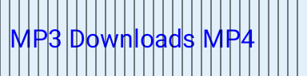
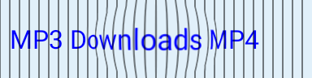

# Ytdlp-G 0.6.6-test — gesture and optical validation

The stable 0.6.4 release is preserved. This isolated test fixes the pointer/spring
conflict and captures the real control content for optics. See the
[root-cause report](REPORT.md), [preservation manifest](BASELINE.json) and
[physical-device procedure](DEVICE_CHECK.md).

## What is demonstrated here

- Deterministic old/new controller reproduction: target 0.8; after 32 **test-clock**
  milliseconds old value 0.5276055 versus direct value 0.8. This is not device latency.
- 60 actual drawing/input samples: no extra composition, source recording or bitmap
  readback while held, with a populated source cache. See [host counters](host-metrics/invalidation.json).
- Actual software pixel displacement: 5,389 changed interior pixels and zero
  changed exterior pixels. [Probe result](optical-probe/result.json).

| Real source fixture | Same texture through the mesh |
| --- | --- |
|  |  |

[Actual control source snapshot](optical-probe/actual-control-source.png) ·
[Held control in the software test window](optical-probe/actual-control-held.png)

The isolated optical fixture has an opaque blue backing to verify that captured
pixels do not hide the moving specular. It does not replace the app's wallpapers.

These are real test renders, not an iOS mockup, a photo or a verified GPU result.
Android 12's proposed HWUI mesh path still needs execution on the Redmi. Android
13+ now feeds real labels/icons to the native lens. No stable 60 FPS or identical
Apple optics are claimed without the physical measurements.

## Existing screens and captured gesture sequences

[0.6.5 before](before/) · [0.6.6 after](after/) — eight matching real UI states,
rendered by the same software test setup with fixture metadata.

| Control | Light | Dark |
| --- | --- | --- |
| MP3/MP4 | [Captured motion](motion/light/format.gif) | [Captured motion](motion/dark/format.gif) |
| Normal/ZIP | [Captured motion](motion/light/files.gif) | [Captured motion](motion/dark/files.gif) |
| Bottom navigation | [Captured motion](motion/light/navigation.gif) | [Captured motion](motion/dark/navigation.gif) |
| Downloads/Completed | [Captured motion](motion/light/history.gif) | [Captured motion](motion/dark/history.gif) |

The 48 original frame PNGs are included. GIFs only replay those captured frames;
no optical effects or intermediate frames are fabricated. Main UI host captures
use the software fallback; the separate pixel probe exercises actual mesh drawing.

## Physical acceptance remains pending

No attached phone or usable accelerated emulator is available here. The matching
instrumentation APK measures real window/GPU frame percentiles and compares the
same production lens with zero/nonzero optical strength. These nine device
cases are compiled, not reported as executed. [Run them on the phone](DEVICE_CHECK.md).

Signing keys may differ from the installed test/stable build. Preserve data before
considering an uninstall after a signature conflict. The application ID is unchanged.
