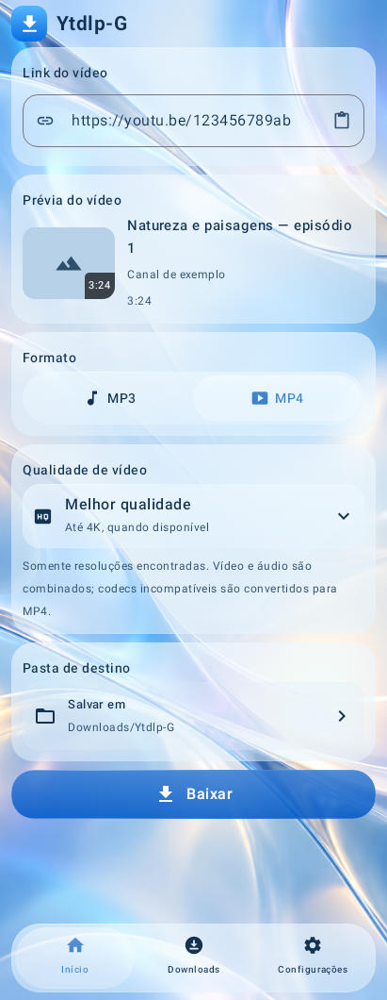
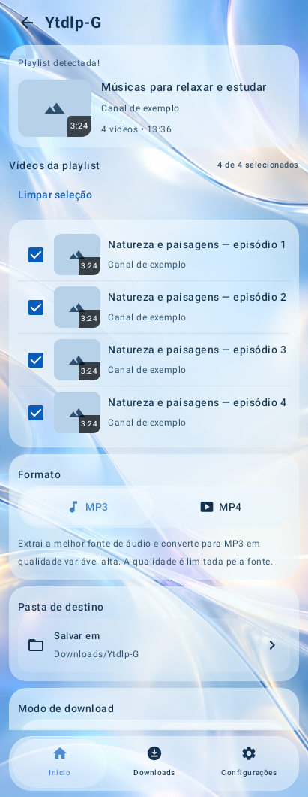
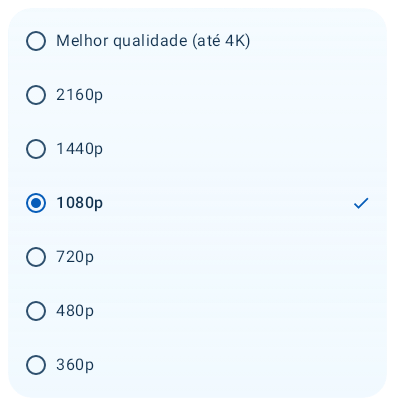
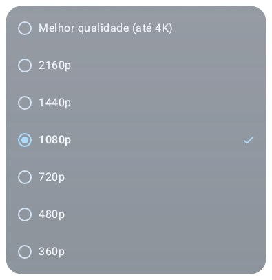

# Ytdlp-G · Liquid Glass 0.6.6-test2

Presentation-only test build on `visual/liquid-glass-total-066`. Stable v0.6.4
and the working download implementation are preserved.

**[Download Ytdlp-G.apk package](https://github.com/fuhbe/Ytdlp-G-Android/actions/runs/40012530091/artifacts/12526504791)**
— extract the APK from the Actions ZIP. See [verified delivery](DELIVERY.md)
before installation; development signing keys differ between builds.

The four shared selectors now combine direct dragging, earlier directional
snapping, bounded elastic edge stretch and progressively illuminated real
icons/text, including inside the lens. The MP4 quality list is an anchored,
focusable glass popup with spring opening, scrolling and unchanged choices.

## Actual software captures

These images/GIFs are **host Compose/Skia fallback renders**, not iPhone artwork,
emulator screenshots, phone GPU proof or video-download success simulations.
They demonstrate the implemented controls/layout/transitions. Advanced optics
and sustained fluidity still need [phone acceptance](DEVICE_CHECK.md).

 

### Moving navigation and progressive color

### Quality popup

 

The main artifact includes the complete before/after set, eight app gesture
sequences and opening/closing frames. The full checksum manifest is in
[EVIDENCE.json](EVIDENCE.json); two raw host counter files are supplied by the
separate verification artifact as explained in [DELIVERY.md](DELIVERY.md).

[Visual implementation, API matrix and modified files](REPORT.md) ·
[Verified APK/tests/checksums](DELIVERY.md) · [Physical-device procedure](DEVICE_CHECK.md)
