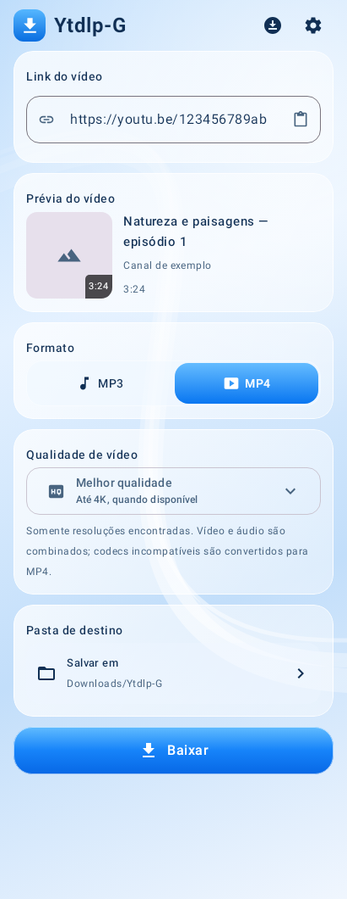
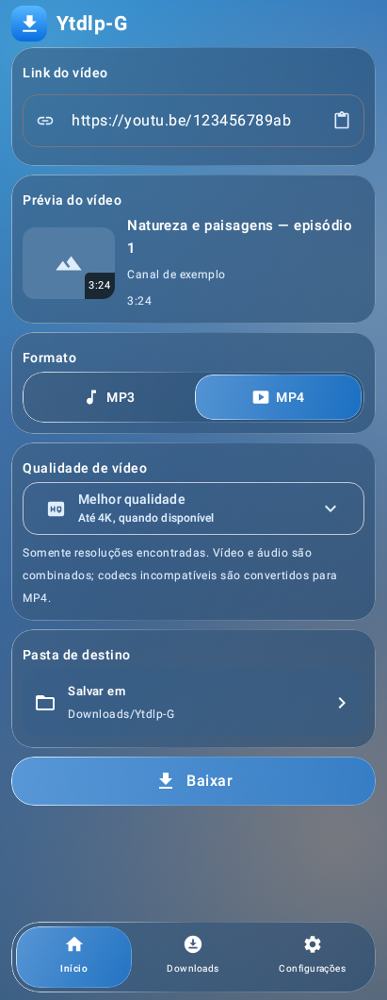
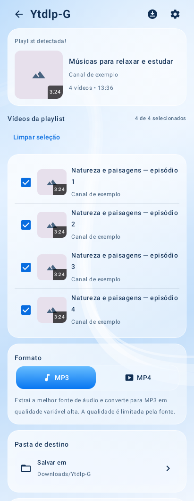
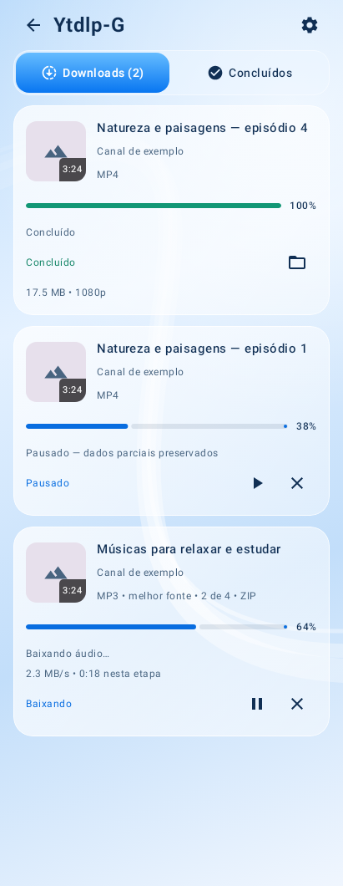
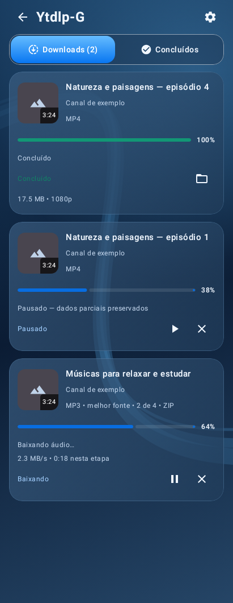

# Ytdlp-G 0.6.3 — visual-only Liquid Glass test

This branch changes the presentation of the minimal application distributed as
0.6.2. It does not replace the working public release. The new test APK keeps
`Ytdlp-G`, `Ytdlp-G.apk`, application ID `com.fuhbe.ytdlpg.minimal`, Android minimum
26 and ARM64. Version code 63 identifies this visual successor.

## Baseline and protected behavior

Before presentation changes, the baseline at commit
`3064edecd8e3c1805ff629f6dcfd181c2b747479` compiled its release APK and matching
instrumentation package and passed all 57 existing JVM tests. See BASELINE.json
and INVENTORY.md. Instrumentation compilation was not a physical-device run.

`verify_scope.py` checks SHA256 for 28 protected source/resource/runtime files,
the exact Activity entry-point/share-intent body and file-opening helpers, 19
presenter contracts, and the build file after removing only version metadata and
the visual dependency. It also rejects changes outside the declared visual,
UI-test, licensing and delivery paths. The runtime, models, worker, extraction,
format rules, FFmpeg plugin, storage/export/ZIP, queue, database, notifications,
services, permissions and original functional tests are unchanged.

The original VM methods and parameters remain in place. The existing back,
Downloads and Settings destinations move into a bottom dock where appropriate;
selected destinations are nonclickable current-page indicators, not duplicate
shortcuts. The playlist's existing Back/clear behavior remains in the header.
The dock's measured height reserves layout space, including with larger fonts.
No new action, format, size badge, menu option or configuration is introduced.
The existing quality dropdown remains a dropdown, with the same extracted
heights, rather than inventing extra rows or sizes from the visual reference.

## Material and compatibility

The dependency is **io.github.kyant0:backdrop:1.0.3**, Apache-2.0, by Kyant.
DEPENDENCIES.json records the resolved before/after graph: Backdrop is the only
added runtime artifact; all existing dependency versions are unchanged.

Backdrop 2.0.0 was inspected but requires compile SDK 37, Compose 1.11.0 and
Kotlin stdlib 2.3.21. Version 1.0.3 provides the required layer capture, Android
RenderEffect blur and RuntimeShader refraction APIs while fitting the existing
SDK 36 / Kotlin 2.3.0 / Compose 1.10.1 stack. Its minimum API is below the app's
unchanged Android 8 minimum. Square was consulted as a reference only; no Square
code, identity or artwork was copied. No Apple assets or private APIs are used.

- **Android 8–11:** translucent blue material, highlights, borders and gradients.
  No unsupported blur or RuntimeShader is instantiated.
- **Android 12/12L:** Backdrop samples the actual captured wallpaper pixels and
  applies supported background blur in a hardware-accelerated view.
- **Android 13+:** essential buttons, selectors and the dock also use the actual
  rounded lens shader. Cards retain cheaper sampled blur. Chromatic aberration
  is disabled. A rejected lens keeps blur and logs a fixed, non-sensitive event.
- **Low RAM, memory class below 192 MB, power saver or software canvas:** the
  inexpensive tint/highlight material. View attachment and focus changes refresh
  capabilities, including after power-saver changes; there is no polling loop.

One static procedural wallpaper layer is shared and cached. Animated text and
progress are not captured into a full-screen texture, and the glass does not
sample itself. UI press feedback uses the original clickable Surface and a
small 120ms scale animation, without installing a new gesture interceptor.
Existing content-size animations and touch feedback remain. Shader caches and
graphics layers follow the Compose/view lifecycle.

There is no new speed setting, background process or downloader optimization.
The capture graph avoids continuous foreground recapture, but real FPS,
manufacturer GPU behavior, peak graphics memory, heat and battery usage still
require measurement on the target phone. A successful JVM layout test does not
prove those hardware characteristics.

## Before/after screens

The original 0.6.2 captures remain in `docs/screenshots/`. Updated real Compose
renders use the same fixture metadata and queue states in
`docs/visual-glass/screenshots/`: single video, playlist, downloads light and
downloads dark. These are **software-fallback UI renders with sample data**,
not live network downloads, generated design mockups or device-GPU captures.
No sample metadata or progress is added to production code.

The new material uses blue translucent surfaces, rounded pill controls,
restrained edge highlights, white text, compact spacing and a bottom dock.
The operational content/visibility and actual metadata remain intact; illustration
items without a matching existing function are deliberately not introduced.

## Automated and native verification

The build reruns every original test unchanged, including actual HTTP/HLS/DASH
fixtures, MP3 conversion, compatible MP4 copy/merge, incompatible codec conversion,
16-item partial-success playlist, ZIP, retry, resume, unavailable items, export
recovery, persistence and initialization regressions. It also reruns the original
media smoke checks, optimized APK/runtime inspection and positive/negative R8
archive controls. Results belong to the exact Actions commit/artifact.

New coverage adds 21 layout renders across APIs 26, 28, 31, 33 and 35 (including
small-screen large text), four before/after preview renders, and seven material/
interaction scenarios: existing navigation/back, format/quality/ZIP model values,
Android folder-picker intent, exact pause/resume/cancel/retry IDs, dock occlusion,
capability fallback and the lens pixel probe.

The host-native Skia in this environment cannot compile even the minimal Android
child-shader control `content.eval(...)`. The lens pixel probe checks that control
first and is explicitly **skipped**, not counted as passing, for this known host
limitation. Other shader errors fail the test. The original 57 tests must all
remain passing. The exact totals/skips are validated by verify_delivery.py and
published in visual-delivery.json; instrumentation builds do not count as runs.

`LiquidGlassDeviceTest` provides actual Android window screenshots, navigation
checks and an API 33+ native shader/backdrop displacement probe. The native probe
checks an unchanged center and displaced checkerboard pixels at a lens edge.
Its shader asset retains the original Apache-2.0 copyright and source. Four
existing native pipeline tests are retained unchanged in the matching test APK.

The available x86 emulator could not provide a usable booted Android device in
this environment (disk/userdata allocation and no hardware acceleration). No
successful emulator or physical-device test, native GPU result, FPS/ANR/memory
measurement or live YouTube test is claimed for this appearance update.

## Run device acceptance

Use a spare installation or first finish/export needed work. CI's fresh test key
can prevent updating 0.6.2 in place. Uninstalling erases private queue/settings/
partials; source compatibility cannot override Android signing rules. Already
exported Downloads/folder files remain. The public 0.6.2 APK is preserved.

Download the application and **Liquid-Glass-device-tests** from the SAME successful
Actions run, then install both matching APKs with Android Platform Tools:

```sh
adb install -r Ytdlp-G.apk
adb install -r Ytdlp-G-tests.apk
adb shell am instrument -w -r -e class com.fuhbe.ytdlpg.simple.LiquidGlassDeviceTest com.fuhbe.ytdlpg.minimal.test/androidx.test.runner.AndroidJUnitRunner
adb pull /sdcard/Android/data/com.fuhbe.ytdlpg.minimal/files/visual-test/
adb logcat -v threadtime YtdlpG-Glass:I AndroidRuntime:E '*:S'
```

On the Redmi 10 Prime / Android 12, the expected accelerated tier is **BLUR**
with power saver off and adequate memory. The lens probe requires Android 13+
and is appropriately skipped on Android 12. The fixed log event reports the
material tier without URLs, titles, commands or paths. No new settings are needed.

Confirm home/playlist/downloads/settings in both themes; actual formats/qualities;
small/large fonts; dropdown contrast; keyboard, cutout and system navigation;
selection/ZIP/folder behavior; pause/resume/cancel/retry/open; normal and background
MP3/MP4 transfers; and memory/frame stability while processing. Re-run existing
NativePipelineTest only after pausing other work. Its current device instructions
in minimal/DEVICE_TESTS.md still apply. Copy normal app diagnostics on a transfer
failure and collect AndroidRuntime causes on a crash.

## Changed implementation and licenses

- `minimal/app/src/main/java/com/fuhbe/ytdlpg/simple/MainActivity.kt`: Compose
  material/layout only; unchanged platform entry points and business callbacks.
- `LiquidGlass.kt`: reusable visual material, wallpaper capture, capability policy
  and existing-destination dock.
- `minimal/app/build.gradle.kts`: version metadata and the single visual dependency.
- Backdrop Apache license/NOTICE assets, a pinned corresponding-source JAR under
  `minimal/vendor/`, and attribution in the existing license dialog.
- Three new JVM UI test files, one native visual test class and its licensed
  shader fixture; original tests untouched.
- Visual-only workflow, scope/delivery guards and this report/baseline/inventory.

Ytdlp-G remains GPL-3.0-only. Backdrop source and Apache-2.0 notices accompany the
corresponding-source distribution and APK. The original downloader dependency
licenses and notices remain intact.

## Comparison gallery (software fallback, sample metadata)

| Screen | 0.6.2 baseline | 0.6.3 visual branch |
|---|---|---|
| Single video |  |  |
| Playlist |  |  |
| Downloads light |  |  |
| Downloads dark |  |  |

These images verify the real component hierarchy and fallback presentation.
Hardware blur/refraction must be reviewed using the native test and a supported
Android GPU; it is not represented as proven by these host images.
