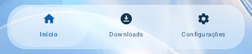

# Square Liquid Glass test previews

[Download the verified test APK and read the installation/signing notes](DELIVERY.md).

Actual Compose software renders of the isolated **0.6.5-test** branch. Sample
metadata is only for layout verification. These images do not demonstrate a
successful download or native AGSL refraction. The approved v0.6.4 release is
preserved. See [the report](REPORT.md) and [source provenance](../../minimal/vendor/square/PROVENANCE.md).

## Motion captured from the app

Each GIF replays six actual frames from a held drag and release. No intermediate
frames, artificial refraction or blur are added. Original PNG frames and their
hashes are listed in [EVIDENCE.json](EVIDENCE.json).

| Existing selector | Light | Dark |
| --- | --- | --- |
| MP3/MP4 | [Motion](motion/light/format.gif) | [Motion](motion/dark/format.gif) |
| Normal/ZIP | [Motion](motion/light/files.gif) | [Motion](motion/dark/files.gif) |
| Bottom navigation | [Motion](motion/light/navigation.gif) | [Motion](motion/dark/navigation.gif) |
| Downloads/Completed | [Motion](motion/light/history.gif) | [Motion](motion/dark/history.gif) |

## Same states before and after

| State | Approved 0.6.4 | Square visual test |
| --- | --- | --- |
| Single video, light | [Before](before/single-video.png) | [After](after/single-video.png) |
| Single video, dark | [Before](before/single-video-dark.png) | [After](after/single-video-dark.png) |
| Playlist, light | [Before](before/playlist.png) | [After](after/playlist.png) |
| Playlist, dark | [Before](before/playlist-dark.png) | [After](after/playlist-dark.png) |
| Downloads, light | [Before](before/downloads.png) | [After](after/downloads.png) |
| Downloads, dark | [Before](before/dark-theme.png) | [After](after/dark-theme.png) |
| Settings, light | [Before](before/settings-light.png) | [After](after/settings-light.png) |
| Settings, dark | [Before](before/settings-dark.png) | [After](after/settings-dark.png) |

Android 12 supports captured-background blur and compatible lighting. Native
refraction requires a capable Android 13+ GPU. The matching device-test APK
contains a moving-production-pane pixel probe; its execution and physical
touch/performance acceptance are pending an attached device.
